# University Management System

## 1. Project Overview

The University Management System is a Spring Boot REST API application designed to manage university information using a multi-database architecture.

The application uses three independent PostgreSQL databases to store student information, course information, and academic grades. Each database has its own DataSource, EntityManagerFactory, and TransactionManager.

The system provides REST API endpoints for managing students, courses, and grades. It also generates student transcripts by combining information from all three databases.

## 2. Project Objectives

- Implement a multi-database architecture using Spring Boot.
- Configure three independent PostgreSQL databases.
- Use Spring Data JPA for database operations.
- Implement REST controllers for CRUD operations.
- Apply a layered architecture.
- Validate incoming requests.
- Verify student and course references when assigning grades.
- Generate student transcripts using data from multiple databases.

## 3. Technologies Used

- Java 21
- Spring Boot 3.5.6
- Spring Web
- Spring Data JPA
- Hibernate
- PostgreSQL 18
- Maven
- REST API
- Postman
- IntelliJ IDEA

## 4. Database Architecture

The application uses three separate PostgreSQL databases:

| Database | Purpose |
|---|---|
| `student_db` | Stores student information |
| `course_db` | Stores course information |
| `grade_db` | Stores student grades |

Each database has an independent database configuration, including its own DataSource, EntityManagerFactory, and TransactionManager.

The grades database stores `student_id` and `course_id` as logical references. These IDs connect records across databases without using traditional foreign key constraints.

## 5. Project Architecture

The application follows a layered architecture:

- **Entity:** Contains JPA entity classes representing database tables.
- **Repository:** Handles database operations using Spring Data JPA.
- **Service:** Contains business logic and application rules.
- **Controller:** Handles HTTP requests and returns REST responses.
- **Configuration:** Defines database connections, EntityManagerFactory, and TransactionManager beans.
- **DTO:** Defines data transfer objects, including the student transcript.
- **Exception:** Contains application-specific exception handling.

The application uses constructor injection to connect its components.

## 6. Main Features

### Student Management

- Create students.
- Retrieve all students.
- Retrieve a student by ID.
- Update student information.
- Delete students.

### Course Management

- Create courses.
- Retrieve all courses.
- Retrieve a course by ID.
- Update course information.
- Delete courses.

### Grade Management

- Assign grades to students.
- Retrieve grades by student ID.
- Store numerical scores and letter grades.
- Automatically calculate letter grades based on numerical scores.
- Verify that the referenced student and course exist.

### Student Transcript

- Retrieve student information.
- Retrieve related course information.
- Display academic grades.
- Calculate the student's average score.
- Combine information from all three databases.

## 7. REST API Endpoints

### Students

| Method | Endpoint | Description |
|---|---|---|
| GET | `/api/students` | Get all students |
| GET | `/api/students/{id}` | Get a student by ID |
| POST | `/api/students` | Create a student |
| PUT | `/api/students/{id}` | Update a student |
| DELETE | `/api/students/{id}` | Delete a student |
| GET | `/api/students/{id}/transcript` | Get student transcript |

### Courses

| Method | Endpoint | Description |
|---|---|---|
| GET | `/api/courses` | Get all courses |
| GET | `/api/courses/{id}` | Get a course by ID |
| POST | `/api/courses` | Create a course |
| PUT | `/api/courses/{id}` | Update a course |
| DELETE | `/api/courses/{id}` | Delete a course |

### Grades

| Method | Endpoint | Description |
|---|---|---|
| POST | `/api/grades` | Assign a grade |
| GET | `/api/grades/student/{studentId}` | Get grades by student ID |

## 8. Database Configuration

Before running the application, create the following PostgreSQL databases:

- `student_db`
- `course_db`
- `grade_db`

The SQL creation scripts are located in:

`src/main/resources/db/`

Database connection settings are configured in `application.properties`.

Default local configuration:

- Host: `localhost`
- Port: `5433`
- Username: `postgres`
- Driver: `org.postgresql.Driver`

The database passwords are provided through environment variables:

- `STUDENT_DB_PASSWORD`
- `COURSE_DB_PASSWORD`
- `GRADE_DB_PASSWORD`

The example configuration file `application.properties.example` is included in the project without real passwords or other secrets.

## 9. How to Run the Project

1. Install JDK 21 or a compatible newer JDK.
2. Install PostgreSQL.
3. Create the three databases.
4. Configure the database connection environment variables.
5. Open the project in IntelliJ IDEA.
6. Load the Maven dependencies.
7. Run `UniversityManagementApplication.java`.
8. Wait until the application starts successfully.

The application runs at:

`http://localhost:8080`

Hibernate is configured with `ddl-auto=update`, so it can create or update the entity tables when the application starts.

## 10. API Testing

The REST API was tested using Postman.

The following operations were tested successfully:

- Creating and retrieving students.
- Retrieving a student by ID.
- Updating and deleting students.
- Creating and retrieving courses.
- Retrieving a course by ID.
- Updating and deleting courses.
- Assigning and retrieving grades.
- Generating a student transcript.

The tested API responses included:

- `200 OK` — successful GET and PUT requests.
- `201 Created` — successful POST requests.
- `204 No Content` — successful DELETE requests.

The Postman collection is included in the project for API testing.

## 11. Example Transcript Result

The following example shows the actual successful transcript response obtained during API testing:

```json
{
  "studentId": 2,
  "firstName": "Aruna",
  "lastName": "Turgun",
  "email": "aruna@example.com",
  "major": "Software Engineering",
  "courses": [
    {
      "courseId": 2,
      "courseName": "Advanced Web Development",
      "courseCode": "WEB101",
      "score": 92,
      "letterGrade": "A-"
    }
  ],
  "averageScore": 92.0
}
```

The transcript combines student details from `student_db`, course information from `course_db`, and grade information from `grade_db`.

## 12. Transaction Management and Data Consistency

Each database has its own TransactionManager. Database operations use the corresponding transaction manager.

Transactions are local to their respective databases. Therefore, a transaction involving one database does not automatically guarantee an atomic transaction across all three databases.

For example, if one database becomes unavailable while generating a transcript, the application may fail to retrieve the complete information.

Another consistency risk occurs when a student or course is deleted while related grade records remain in `grade_db`. Because the databases do not share traditional foreign key constraints, these references require additional application-level handling.

Possible solutions for stronger cross-database consistency include distributed transactions, retry mechanisms, and compensating operations.

Distributed transaction management is not implemented in this project.


## 13. Screenshots

All screenshots were captured during API testing in Postman.

### Student Management

**1. List students**

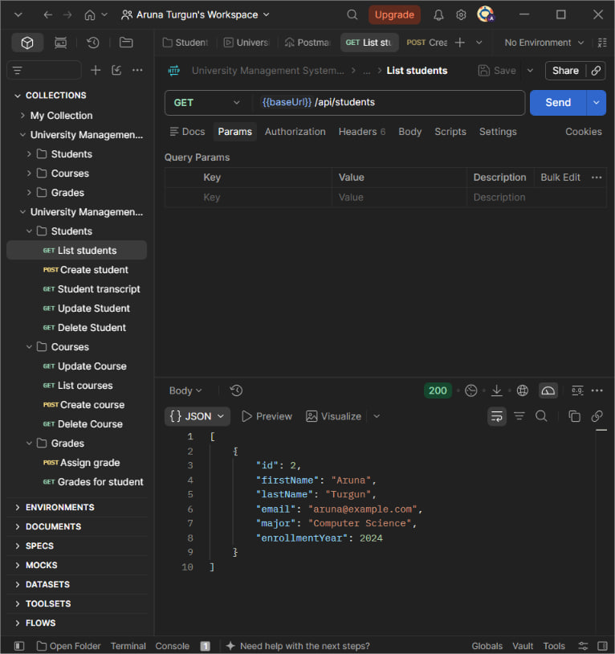

**2. Create student**

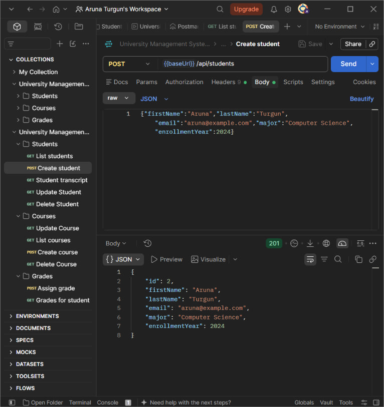

**3. Update student**


**4. Get student by ID**

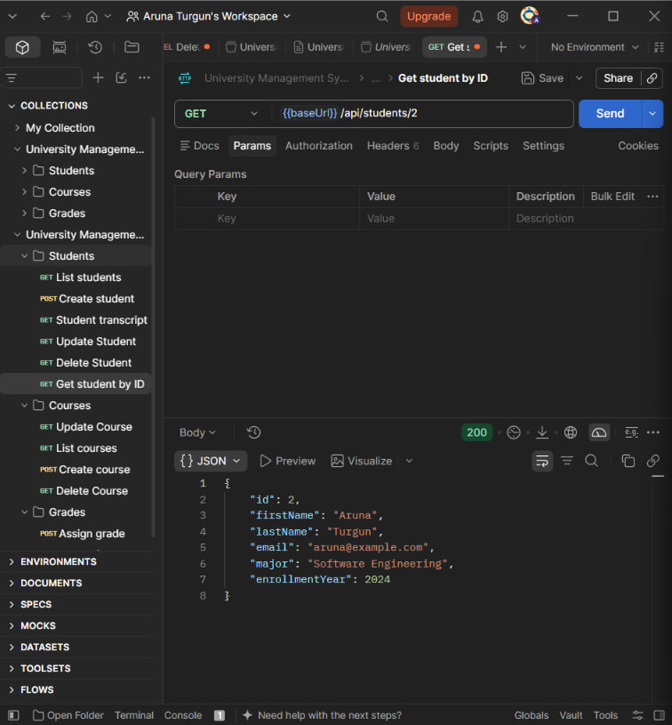

**5. Delete student**

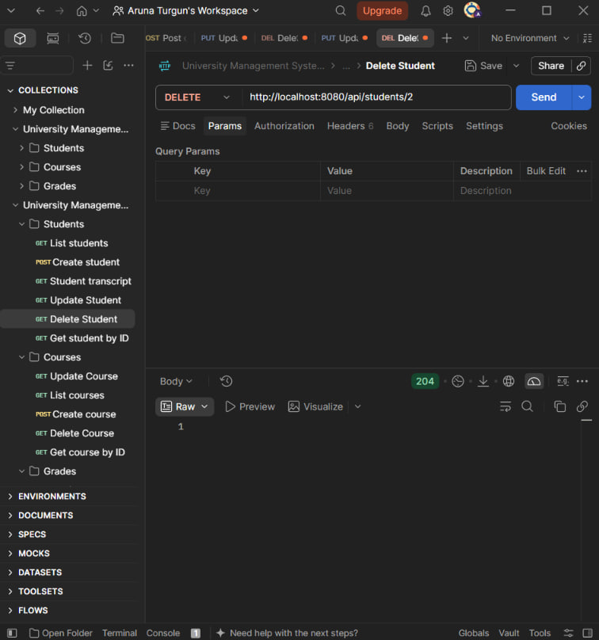

### Course Management

**6. Create course**

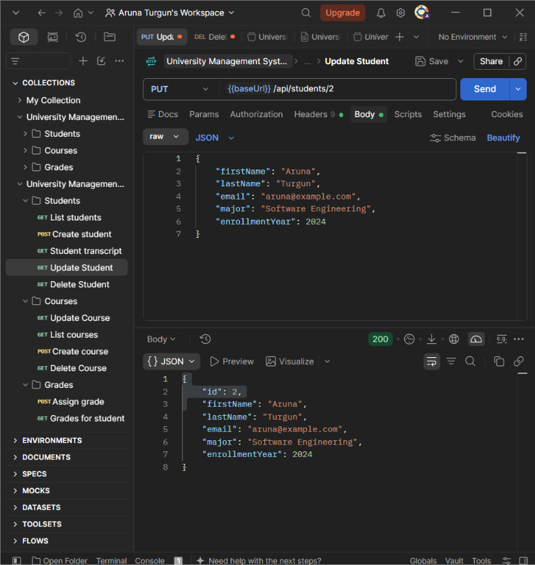

**7. List courses**

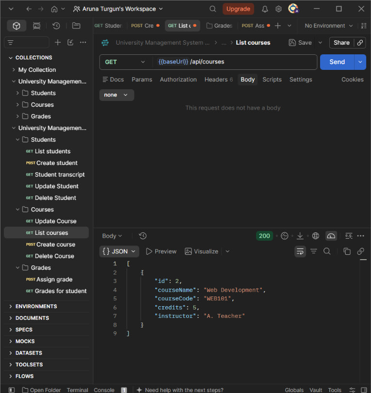

**8. Update course**

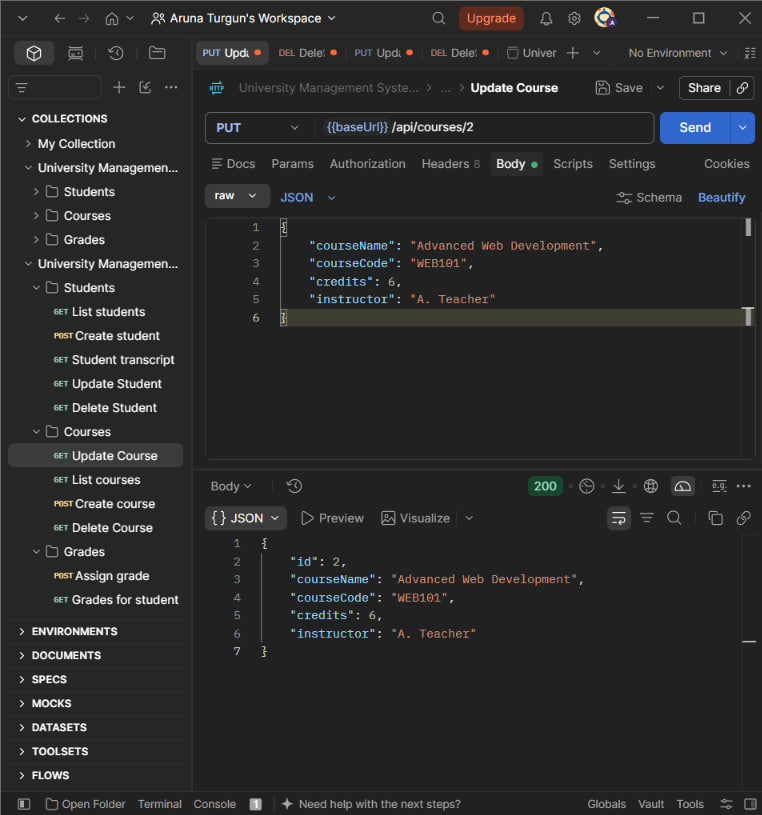

**9. Get course by ID**

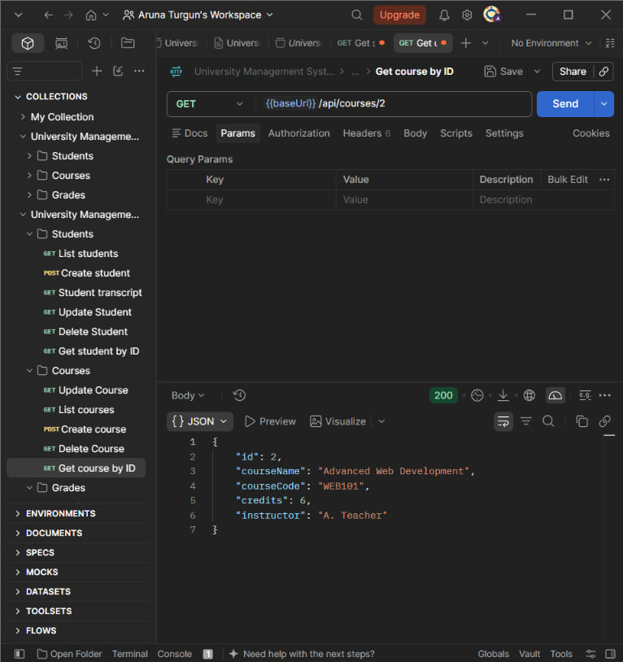

**10. Delete course**

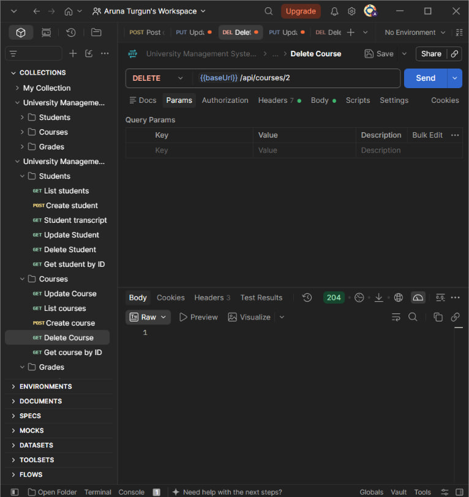

### Grade Management

**11. Assign grade**

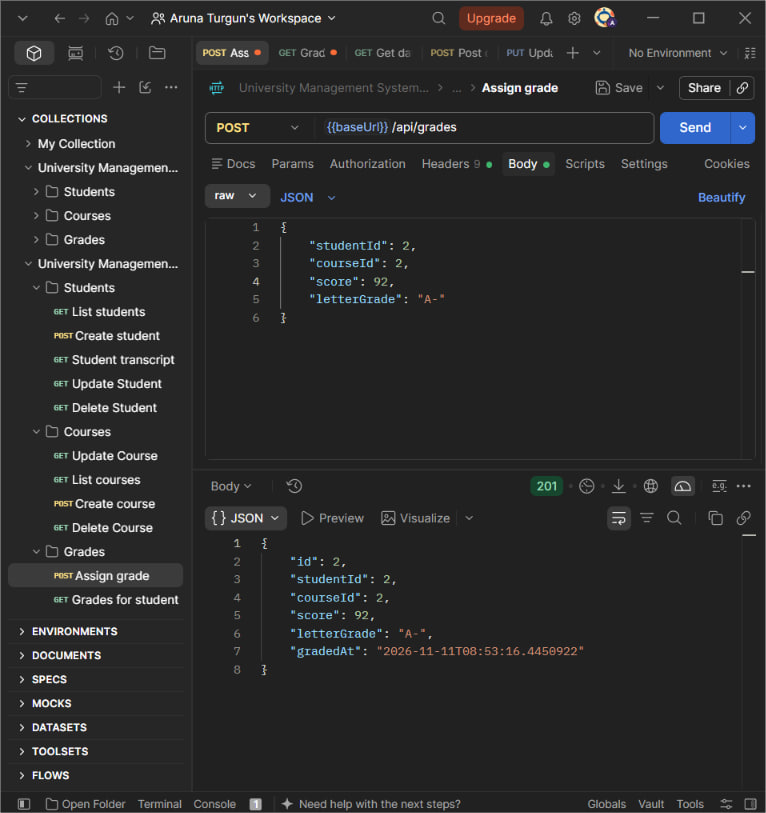

**12. Grades for student**

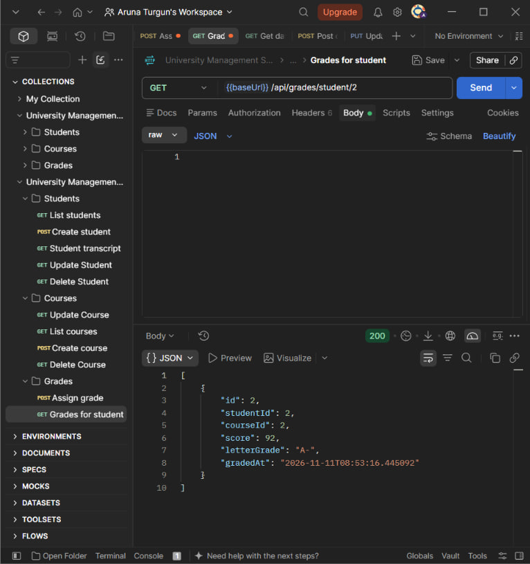

### Student Transcript

**13. Student transcript**

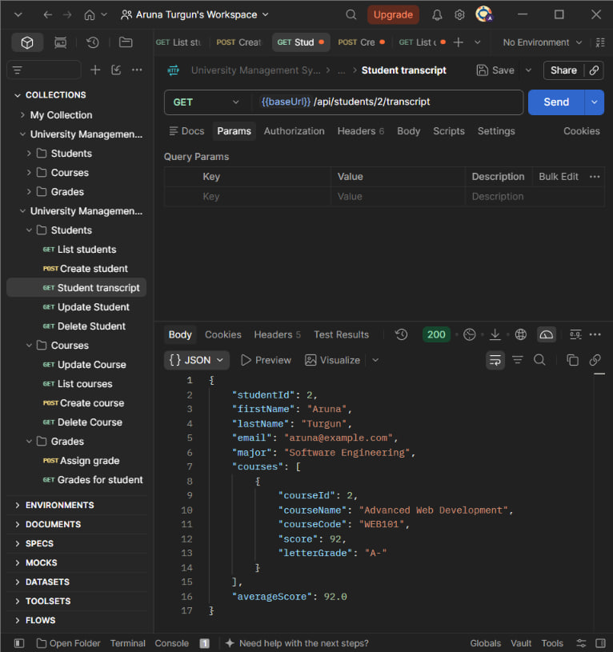


## 14. Conclusion

The University Management System demonstrates how to build a Spring Boot REST API application using multiple independent PostgreSQL databases.

The project implements separate database configurations, Spring Data JPA repositories, layered application architecture, REST API operations, request validation, transaction management, and cross-database transcript generation.

The application successfully retrieves and combines student, course, and grade information from three separate databases to generate a student transcript.